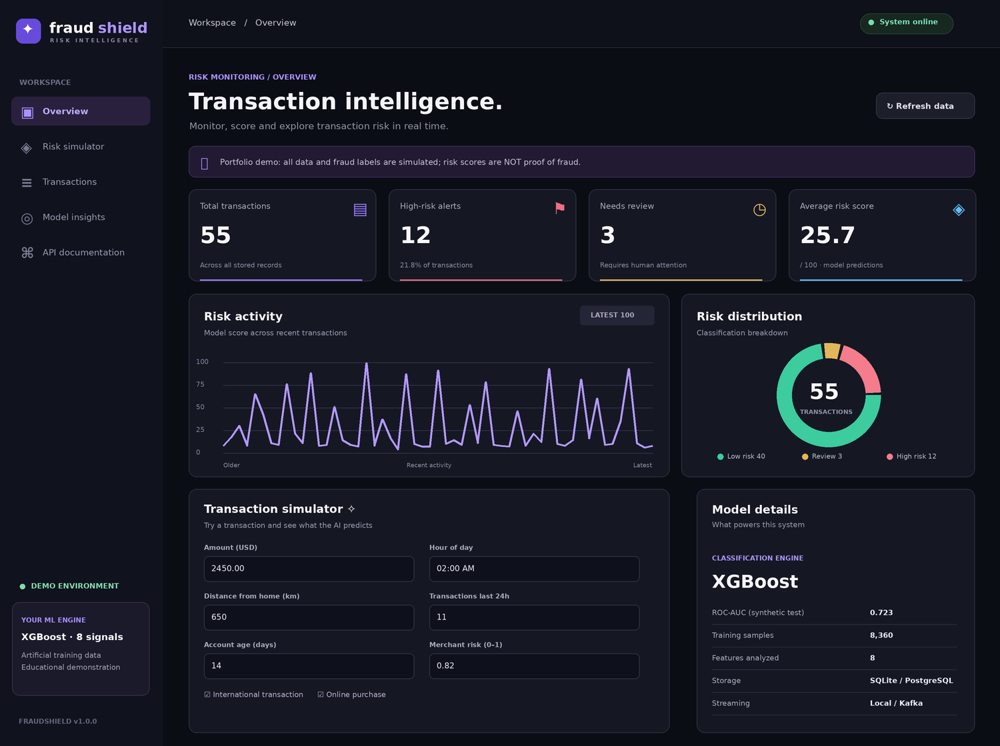

# FraudShield — Fraud Detection & Risk Scoring

**An end-to-end, educational fraud-risk scoring system** using XGBoost, FastAPI, PostgreSQL, Kafka, Docker, and interactive dashboards. It includes a synthetic transaction demo and a separately trained benchmark on anonymized **historical real credit-card transactions**.

**Historical-data held-out benchmark:** ROC-AUC **0.9815** · Average precision (PR-AUC) **0.7906** · Precision **88.33%** · Recall **71.62%** · F1 **0.7910**

> **Scope and safety:** FraudShield is a student portfolio project, not a real payment processor or production fraud decision system. The interactive demo uses synthetic transactions, and the historical benchmark has not been validated for modern, live banking use. Risk scores are estimates, not verified fraud. Do not use it for real financial decisions.



## What it does

- **Scores transactions:** an eight-feature XGBoost model estimates risk and classifies transactions as LOW RISK, REVIEW, or HIGH RISK in the default synthetic demo.
- **Serves a REST API:** FastAPI provides scoring, transactions, aggregate metrics, model information, and automatic OpenAPI docs.
- **Stores and displays results:** SQLite for a lightweight local demo, or PostgreSQL in Docker; a browser dashboard plus optional Streamlit analytics.
- **Demonstrates event streaming:** Docker Compose can run a Kafka producer and independent worker. Event IDs and a unique database constraint guard against duplicate writes on event redelivery.
- **Supports historical benchmarking:** a second XGBoost model inside the same FastAPI application can score the 30 features of the ULB credit-card dataset, once its separately supplied model artifact is installed or trained.
- **Includes engineering checks:** pytest, GitHub Actions, Docker/Kafka smoke tests, optional API-key checks, and a per-process rate limiter.

### Architecture

```text
Default demo:  Browser/Streamlit → FastAPI → XGBoost (8 synthetic features)
                                           ↓
                                       SQLite
Docker demo:   Browser/Streamlit → FastAPI → Kafka topic → Worker → XGBoost
                                                             ↓
                                                         PostgreSQL

Historical model: 30 ULB input features → FastAPI /api/score-real
                                          → separately trained XGBoost
```

The default UI does **not** automatically use the historical model; the models have different input schemas.

## Historical fraud benchmark

Trained and evaluated on the historical, anonymized [ULB Credit Card Fraud Detection dataset](https://www.kaggle.com/datasets/mlg-ulb/creditcardfraud). After cleaning, **283,726** transactions remained; **56,746** were reserved as a chronological held-out test set.

| Metric | Held-out test result |
|---|---:|
| ROC-AUC | **0.9815** |
| Average precision (PR-AUC) | **0.7906** |
| Precision | **88.33%** |
| Recall | **71.62%** |
| F1 | **0.7910** |
| Brier score | **0.00078** |
| Decision threshold chosen on validation data | **0.95** |

**Evaluation design:** chronological 60% train / 20% validation / 20% test split, three walk-forward validation folds within the training period, class-imbalance weighting, and threshold selection on validation F1. The held-out test set was not used for threshold selection. The Brier score is a diagnostic, **not** evidence of completed probability calibration.

Full metrics, including walk-forward results: [`benchmarks/real_metrics.json`](benchmarks/real_metrics.json).

**Limitations:** Historical data and anonymized features limit interpretation; the test metrics do not demonstrate robustness to current transaction patterns, dataset drift, or a real payments environment.

## Quick start — working synthetic demo

Install **Python 3.11 or 3.12**, clone this repository, and open its root in a terminal.

**Windows PowerShell**

```powershell
py -3.11 -m venv .venv
.venv\Scripts\python.exe -m pip install -r requirements.txt
.venv\Scripts\python.exe run.py
```

**macOS / Linux**

```bash
python3 -m venv .venv
.venv/bin/python -m pip install -r requirements.txt
.venv/bin/python run.py
```

The first run automatically trains the **synthetic-data** XGBoost model and initializes a local SQLite database. No external dataset or API key is needed to try this local mode.

Open:

- **Dashboard:** http://127.0.0.1:8000
- **API documentation:** http://127.0.0.1:8000/docs

In the dashboard, click **Generate 55 demo transactions**, adjust transaction features, and try **Analyze transaction**. **Stream event** scores directly in local mode, but uses Kafka when the Docker configuration is enabled.

**Static preview only:** open [`dashboard_preview.html`](dashboard_preview.html) in a browser; it shows mock data and its buttons do not run the model.

### Optional Streamlit analytics

Keep the API running and start a second terminal:

```powershell
.venv\Scripts\python.exe -m streamlit run streamlit_app.py
```

Visit http://127.0.0.1:8501. On macOS/Linux, replace the Python executable with `.venv/bin/python`.

### Docker / Kafka / PostgreSQL

Install and start Docker Desktop, then:

```bash
docker compose up --build
```

The Compose stack runs five services: `api`, `postgres`, `kafka`, `worker`, and `streamlit`. Visit http://localhost:8000 (dashboard), http://localhost:8000/docs (API), or http://localhost:8501 (Streamlit). Use `docker compose down` to stop. **`docker compose down -v` deletes persisted demo data and model volumes.**

Kafka route: `/api/ingest` → `fraud.incoming` → worker → inference → PostgreSQL. The worker stores a stable event ID so replaying the *same event ID* does not create a duplicate database record. This does not guarantee end-to-end exactly-once delivery across independent client retries.

## Run the historical-data model (same project)

This mode is **optional**, and its binary model and dataset are excluded from GitHub.

**Option A — reproduce training:** Download `creditcard.csv` from the [ULB/Kaggle dataset](https://www.kaggle.com/datasets/mlg-ulb/creditcardfraud), review its usage conditions, and place it at `data/creditcard.csv`. From the project root, run:

```bash
python -m ml.train_real
```

Use your virtual-environment Python where appropriate. This writes `models/fraud_real_xgboost.joblib` and `models/real_metrics.json`.

**Option B — use the separately provided trained ZIP:** Extract its `models/` directory to the project root, using model files from a source you trust. Serialized joblib files can execute code on load; **never load untrusted model binaries**.

Start `run.py` and visit:

- **Historical model evaluation:** http://127.0.0.1:8000/api/real-model
- **Historical inference API:** `POST /api/score-real` at http://127.0.0.1:8000/docs

The historical inference API requires exactly 30 numeric inputs: `Time`, `V1`–`V28`, and `Amount`. They are not interchangeable with the default eight dashboard inputs.

## API controls and reliability

- Set `FRAUDSHIELD_API_KEY` to require the `X-API-Key` header on non-health API routes. This is **optional** for trusted local demos; leaving it unset is not appropriate for public exposure. Do not embed secrets in frontend JavaScript.
- `FRAUDSHIELD_RATE_LIMIT` defaults to **120 requests per minute per client IP per process**. This basic in-memory safeguard is not distributed rate limiting.
- The sample Docker configuration uses development credentials and is **not hardened for the public internet**. Public deployment would require secret management, TLS, network controls, stronger authentication, and shared rate limiting.
- Kafka event IDs make database writes idempotent for redelivery of the same event ID; client retries with new event IDs are not deduplicated.

## Code map

```text
app/
  main.py             FastAPI routes, dashboard and Kafka producer
  risk.py             Eight-feature synthetic model inference
  real_risk.py        Thirty-feature historical model inference
  schemas.py          Request validation
  db.py               SQLite/PostgreSQL models and sessions
  worker.py           Kafka consumer
  static/             HTML/CSS/JavaScript dashboard
ml/
  train.py            Synthetic data and XGBoost training
  train_real.py       Historical ULB data training and evaluation
benchmarks/
  real_metrics.json   Published historical held-out metrics
tests/
  test_api.py         API and event-ID behavior
  test_validation.py  Input validation
  test_real_model.py  Historical inference input checks
  test_benchmark_report.py Published metrics checks
  smoke_compose.py    Docker/Kafka/PostgreSQL integration smoke test
compose.yaml          Local multi-service stack
streamlit_app.py      Additional analytics interface
```

## Tests

```bash
python -m pytest -q
```

GitHub Actions runs Python tests and a Docker integration job for pushes and pull requests. See [Actions](../../actions) for the latest status; a green unit-test job is not a substitute for production reliability validation.

## Interview-ready summary

> Built FraudShield, an educational fraud-risk scoring application using XGBoost, FastAPI, Kafka, PostgreSQL, Docker, and interactive dashboards. Developed a separate historical-data model evaluated on 283,726 cleaned ULB credit-card transactions, achieving 0.9815 ROC-AUC and 0.7906 PR-AUC on a chronological held-out test set. Added duplicate-event protection, API access controls, and automated testing.

## License

No open-source license has been selected yet. Repository visibility alone does not grant reuse rights.
